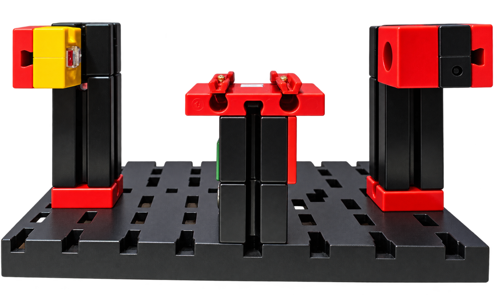

# 3-Achs-Roboter: Erweiterung um eine Lichtschranke

## Bisheriger Stand

Im Sketch `ft_3_Achs_Robot.ino` waren zwei Positionsspeicher PsA und PsB vorgesehen:

- PsA wurde über Eingang I6 gestartet.
- PsB wurde über Eingang I5 oder den analogen Eingang I8 gestartet.
- Eingang I7 war unbelegt.

Der Metallsensor an I6 erkennt metallene Gegenstände auf dem Umsetzer des Roboters.

## Hardwareerweiterung

Der Umsetzer wurde um eine Lichtschranke an Eingang I7 ergänzt. Sie besteht aus einer Linsenlampe (Art.-Nr. 37875) und einem Fototransistor (Art.-Nr. 036134), beide von fischertechnik.
Damit können auch Kunststoffteile erkannt werden, sofern sie den Lichtstrahl ausreichend unterbrechen.  
Der [Schaltplan](Schaltplan-Metall-u-Plast.jpg) zur Installation der Lichtschranke.   
Die für die Lichtschranke benötigten Bauteile [Stückliste Lichtschranke](../Stücklisten/Einzelteile-Lichtschranke.pdf).

## Softwareänderungen

- Ein dritter Positionsspeicher PsC wurde hinzugefügt.
- Jeder Positionsspeicher fasst maximal 18 Positionen.
- Die Speicherwahl im Menü Speicher erfolgt mit Taste 8 in der Reihenfolge PsA → PsB → PsC → PsA.
- Die Startfunktion über I5 wurde vollständig entfernt.
- Der Dauerbetrieb wurde aus Menü und Ablaufsteuerung entfernt.
- Das Automatikmenü wurde entsprechend angepasst.

## Auswahl der Bewegungsabläufe

Die Signale von Metallsensor und Lichtschranke werden gemeinsam ausgewertet:

- I6 aktiv: PsA wird gestartet, unabhängig von I7.
- Lichtschranke an I7 unterbrochen und I6 inaktiv: PsC wird gestartet.
- Logikpegel an I8 (mindestens 5 V): PsB wird gestartet.

Bei unterbrochener Lichtschranke liefert `ftduino.input_get()` für I7 den Wert 0.

Die Erkennung an I6/I7 muss eine Sekunde stabil sein. Die ermittelte Teilezuordnung bleibt anschließend erhalten, bis beide Sensoren eine Sekunde durchgehend einen freien Umsetzer melden. Dadurch löst das Entfernen eines Metallteils keinen nachträglichen Start von PsC aus.

Die Standard-LED zeigt die Teilezuordnung an:

- Blinkend: Metallteil erkannt.
- Dauerlicht: Kunststoffteil erkannt.
- Aus: Umsetzer frei.

Während ein Bewegungsablauf läuft, wird kein weiterer gestartet. Gleichzeitig eintreffende Startsignale werden nicht zwischengespeichert. Bei gleichzeitiger Erkennung haben PsA/PsC Vorrang vor PsB.

Die Bewegungsabläufe müssen im jeweiligen Positionsspeicher hinterlegt sein. Die bisherigen Positionen von PsA und PsB bleiben erhalten; PsC ist zunächst leer.

Die Erweiterung wurde im Zusammenspiel mit dem Hochregallager getestet. Die Erkennung von Metall- und Kunststoffteilen sowie die bestehenden Funktionen arbeiteten dabei ohne erkennbare Probleme.

[Zurück zur Dokumentation](../README.md#dokumentation)
